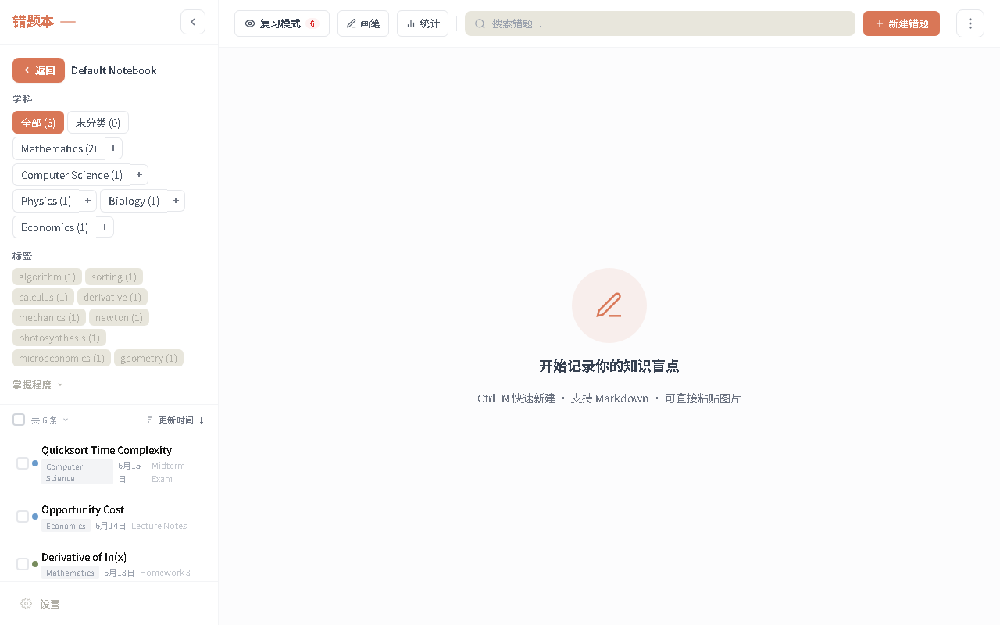
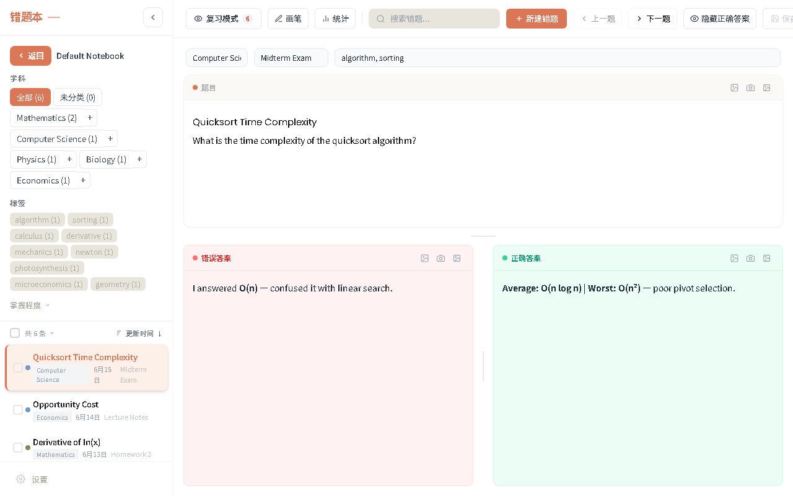

# Note App Clean

官网入口已集成在当前项目中：`/` 为官网首页，`/app/` 为网页版，`/docs/` 为使用文档，`/download/` 为桌面版下载页。运行开发服务即可预览；安装包未配置时会显示待发布状态。[官网维护与部署说明](docs/official-site.md)。

一个围绕错题整理、复习追踪和学习资料管理打造的全栈项目。它从本地优先的笔记应用出发，逐步扩展到了登录认证、远程同步、数据库迁移和后续 AI Agent 接入能力。


<p align="center">
  
  
</p>

## Project Highlights

- 本地优先 + 远程同步：前端可先写入本地，再通过 API 同步到 MySQL
- 前后端一体化：包含 Vue 3 前端、FastAPI 后端、SQLAlchemy ORM、Alembic 迁移
- 认证系统已落地：支持注册、登录、JWT 鉴权、当前用户信息接口
- 业务结构清晰：notebooks、entries、review_logs、users 等模块已拆分
- 可继续扩展 AI：已经为后续接入 DeepAgents / LangChain 留出了后端演进空间

## Overview

这个项目适合用来展示以下几类能力：

- 前端界面开发与状态管理
- 后端接口设计与数据库建模
- 登录认证与会话管理
- 本地存储和远程持久化的双数据流设计
- 从单体学习项目逐步演进到 AI 应用的工程思路

它既可以作为学习型作品集项目，也可以继续往“学习助手 / 错题 AI 助手”方向扩展。

## Core Features

- 错题本 / 笔记本管理
- 条目创建、编辑、删除、搜索
- 标签、学科、素材类型筛选
- 复习记录与统计
- 登录、注册、当前用户鉴权
- 本地离线数据存储
- 远程 MySQL 数据持久化
- Alembic 迁移管理
- Electron 桌面端打包

## Login System

当前登录系统基于 FastAPI + JWT 实现，核心能力包括：

- 用户注册：`/api/users/signup`
- 用户登录：`/api/login/access-token`
- 获取当前用户：`/api/users/me`
- 邮箱验证码：`POST /api/auth/email-code`（`purpose` 为 `signup` 或 `reset_password`）
- 忘记密码：`POST /api/auth/reset-password`
- 登录后修改密码：`POST /api/users/me/password`（设置 → 账号 → 修改密码）
- 密码安全存储：使用哈希而不是明文密码
- 前端鉴权接入：请求通过 `Authorization: Bearer <token>` 调用后端接口

目前这套认证系统已经能完成：

- 新用户注册
- 登录后保存 token
- 页面刷新后维持登录态
- 受保护接口按登录状态访问

新注册需要输入邮箱收到的 6 位验证码；登录页的「忘记密码？」可通过验证码重置密码。
已注册用户仍可直接登录。修改或重置密码后，所有旧 JWT 都会失效，需要重新登录。
验证码有效期为 10 分钟，60 秒后可重发，同一邮箱每种用途每小时最多发送 5 次，
单个验证码最多允许 5 次错误尝试，使用后立即失效。验证码以 HMAC 摘要保存。

启用前执行 `alembic upgrade head`，并在本地 `.env` 配置 `.env.example` 中的
`SMTP_HOST`、`SMTP_PORT`、`SMTP_USERNAME` 和 `SMTP_PASSWORD`。`SMTP_FROM` 留空时使用登录邮箱。
465 端口使用 `SMTP_SSL=true`、`SMTP_STARTTLS=false`；587 端口使用
`SMTP_SSL=false`、`SMTP_STARTTLS=true`。密码填写邮件服务的 SMTP 授权码或应用密码。
后端重启后生效；邮件服务未配置或投递失败时，页面会显示明确提示，不会假报发送成功。
Windows 下修改 `.env` 后，可运行 `npm run dev:restart-backend` 单独重启后端。
该命令检查项目 Python 路径和端口归属，只重启当前项目监听 8000 端口的后端，并更新开发服务状态。

默认使用 QQ 邮箱：`SMTP_HOST=smtp.qq.com`、端口 `465`、SSL 开启。
`SMTP_USERNAME` 填完整的发件 QQ 邮箱地址，`SMTP_PASSWORD` 填
QQ 邮箱开启 SMTP 服务后生成的授权码。授权码只保存在本地 `.env`，不要提交到仓库。

## Tech Stack

### Frontend

- Vue 3
- TypeScript
- Vite
- Tailwind CSS
- Electron

### Backend

- FastAPI
- SQLAlchemy ORM
- MySQL
- Alembic
- PyJWT
- pwdlib / Argon2 password hashing

### Storage

- IndexedDB
- MySQL

## Project Structure

```text
notes-app-clean/
├─ alembic/                 # Alembic migration files
├─ electron/                # Electron main/preload
├─ src/
│  ├─ components/           # Vue UI components
│  ├─ composables/          # Frontend business logic
│  ├─ db_sql/               # FastAPI backend, models, routers, auth
│  ├─ services/             # API / local data access layer
│  ├─ types/                # TypeScript types
│  └─ utils/                # Utility functions
├─ tests/                   # E2E and related tests
├─ package.json
├─ requirements.txt
└─ alembic.ini
```

## Technical Challenges

这个项目里比较有代表性的技术点，不只是“把功能写出来”，更在于把不同层连接起来：

- 本地存储和远程数据库并存
  - 浏览器侧有 IndexedDB，本地可先使用
  - 后端侧有 MySQL，负责远程持久化
  - 这要求前端服务层处理同步、回写和鉴权

- 登录系统接入现有项目
  - 原项目最开始不是围绕用户体系设计的
  - 接入 JWT 认证时，需要同时改路由、前端请求层、登录页、设置页和本地状态

- 数据库结构演进
  - 从直接 `create_all` 的学习式写法，过渡到 Alembic 管理迁移
  - 这意味着后续改表要走 revision / upgrade，而不是运行时自动改表

- 学习数据按用户归属隔离
  - `users` 与 `notebooks`、`note_entries` 均为一对多关系，通过非空 `user_id` 外键关联
  - 新建数据从 JWT 登录身份确定归属，客户端不能修改归属
  - 题组通过笔记本、复习记录通过题目继承权限；读取、修改、删除和同步均检查当前用户
  - IndexedDB、Electron 数据目录和离线同步队列按账号分开，登录/退出时重新加载页面

## AI Agent Roadmap

### 已接入 RAG 入口

首页的“开始复习”入口通过当前后端 `POST /api/review-agent/query` 调用
`shopkeeper_brain` 的 `POST /query`。发送问题后展示实际回答，支持等待状态、
失败重试和按账号保存聊天记录；服务端为每个账号隔离会话 ID。
聊天记录支持左划（鼠标也可向左拖动），从右侧显示“删除”和“重命名”；也可点击每条记录旁的“⋯”展开或收回。
删除经 `DELETE /api/review-agent/history/{session_id}` 调用智能体的 `DELETE /history/{session_id}`，
成功后才移除本地记录；失败时保留记录并支持重试。重命名保存在当前账号的本地聊天记录中。

在另一终端启动现有查询服务：

```powershell
Set-Location G:\pycharm\shopkeeper_brain
.\knowledge\.venv\Scripts\python.exe -m uvicorn knowledge.api.query_router:create_app --factory --host 127.0.0.1 --port 8001 --reload
```

当前后端 `.env` 可配置 `RAG_AGENT_URL`（默认 `http://127.0.0.1:8001`）和
`RAG_AGENT_TIMEOUT_SECONDS`（默认 180 秒）。两个项目各用自己的虚拟环境与配置。
复习助手默认使用流式查询：后端以 `is_stream=true` 提交任务，再逐块转发 `/stream/{task_id}` 的 SSE；前端实时显示答案增量和独立的处理说明。显式传 `is_stream=false` 仍可取得完整 JSON 答案。
知识库选择仍保存为本地记录，资料与错题同步、检索流程由后续开发接入。

这个项目后续最适合扩展的不是“自动录入错题”，而是“学习辅助 Agent”。当前比较合理的方向是：

- 读取错题并做薄弱点总结
- 根据标签、学科、复习记录给出学习建议
- 帮用户分析某一题为什么错
- 搜索相似错题
- 生成每日复习计划

建议的接入顺序：

1. 先做只读 Agent
2. 先让 Agent 查数据、分析数据、返回建议
3. 再考虑带确认的写操作
4. 最后再考虑更复杂的多轮记忆和工具链

如果继续往下做，比较适合接入：

- DeepAgents
- LangChain / LangGraph
- DeepSeek 或 OpenAI 模型接口
- LangSmith tracing

## Local Development

### Frontend

```bash
npm install
npm run dev
```

### Backend

```bash
python -m venv .venv
.venv\Scripts\activate
pip install -r requirements.txt
uvicorn src.db_sql.main:app --reload
```

### 一键启动（Windows）

双击项目根目录的 `start-dev.cmd`，启动器会依次检查 MySQL、启动 FastAPI、启动 Vite，并在服务就绪后打开网页。双击 `stop-dev.cmd` 可以停止由启动器创建的前端和后端进程；MySQL 服务不会被关闭。

也可以在终端中运行：

```bash
npm run dev:all
npm run dev:status
npm run dev:stop
```

运行日志保存在 `.dev-services` 目录。设置环境变量 `MYSQL_SERVICE_NAME` 可以修改 Windows MySQL 服务名，默认值为 `MySQL80`。

已有数据库如果出现带图片题目同步失败、`Data too long for column 'material'` 等错误，请执行一次 `.\.venv\Scripts\python.exe -m src.db_sql.migrate_rich_text`。该迁移只把题干、两种答案和公共材料的文本字段扩为 `LONGTEXT`，保留内容并支持重复执行。新建数据库的模型已使用相同字段类型。

## Environment Variables

项目使用 `.env` 管理后端配置，常见变量包括：

```env
MYSQL_HOST=localhost
MYSQL_PORT=3306
MYSQL_USER=root
MYSQL_PASSWORD=your_password
MYSQL_DATABASE=notes_app_db
JWT_SECRET_KEY=your_jwt_secret
ACCESS_TOKEN_EXPIRE_MINUTES=10080
```

如果后续接入大模型或 Agent，建议继续在同一个 `.env` 中配置模型密钥，例如：

```env
DEEPSEEK_API_KEY=your_key
LANGSMITH_API_KEY=your_key
LANGSMITH_TRACING=true
LANGSMITH_PROJECT=notes-app-agent
```

## Database Migration

常用 Alembic 命令：

```bash
alembic revision --autogenerate -m "your message"
alembic upgrade head
```

用户归属迁移会把已有笔记本和题目绑定到数据库中唯一的用户。若已有多个用户且存在旧数据，必须明确指定旧数据归属，然后运行：

```bash
alembic -x legacy_user_id=<existing-user-id> upgrade head
```

旧本地缓存仅迁移后端确认属于当前用户的笔记本；原始缓存和文件保留，未同步的旧笔记本可从原始数据导出后导入对应账号。

后端权限回归检查：`python -m unittest discover -s tests/backend -v`（测试需要 `httpx`）。Agent 调用必须在服务端使用 `agent_user_scope(current_user.id)` 绑定用户身份，未绑定时搜索工具拒绝执行。

## Notes

错题本入库入口：开始复习 → 知识库管理 → 管理知识库。先新建或选择目标知识库，再选择服务器上的错题本并点击「执行入库」。仅该动作更新Milvus索引；正常编辑不会自动写入。重复执行按内容指纹处理新增、修改和删除，公共材料修改会重建关联小题，复习进度变化会跳过。页面展示进度和失败项，失败后可手动重试。「移除该错题本索引」保留原始业务错题。选中的知识库ID会传给查询服务以限定错题检索范围。

需要先执行数据库迁移创建 `notebook_indexes`。当前后端与RAG均按单worker运行；服务重启后中断任务需要用户重新点击执行。单题索引请求超时可通过 `RAG_INDEX_TIMEOUT_SECONDS` 配置，默认600秒。

复习助手统计分支通过登录后端的 `POST /api/review-agent/stats` 只读查询 MySQL，支持数量、学科/标签分布、日期趋势、复习正确率和有限记录列表。日期按北京时间，错题统计使用收录时间，复习统计使用作答时间；知识点只能统计已标注标签。查询适配器将登录JWT转发给RAG，再由统计接口重新验证当前账号，禁止指定其他用户或任意SQL。RAG端的 `NOTES_API_URL` 默认指向 `http://127.0.0.1:8000`，部署到虚拟机时配置为可访问的后端地址。

- 当前项目同时存在本地存储和远程后端两套数据路径
- MySQL 题目与笔记本已绑定登录用户；题组与复习记录继承各自父级数据的权限
- 当前已经具备继续扩展成学习型 AI Agent 项目的基础

## License

MIT
